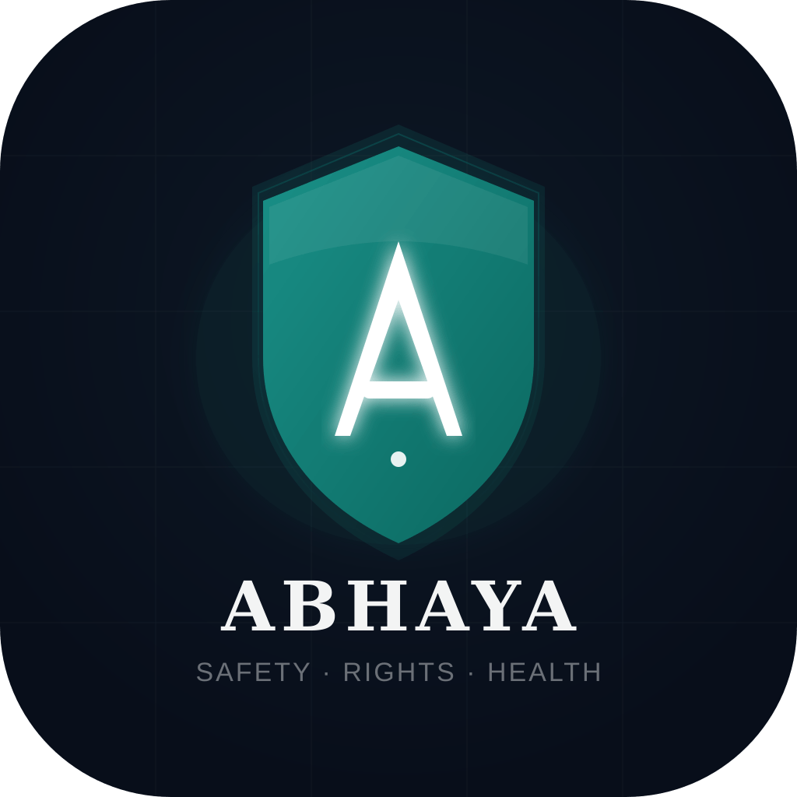

<div align="center">
  
  <h1>Abhaya</h1>
  <p><strong>The app that has your back. When nothing else does.</strong></p>
  <p>
    Safety · Legal Rights · Evidence Vault · Health · Community
    <br />
    Built for women in India. Works when the system doesn't.
  </p>

  <p>
    
    
    
    
    
    
  </p>
</div>

---

## Why Abhaya exists

India has 20+ women's safety apps. They all make the same mistake — they assume the police respond, the system works, and legal information is accessible. They're wrong on all three.

- 86+ rapes are reported **every day** (NCRB 2021)
- For every case registered, **70 go unreported**
- **75% of women** don't trust police to respond
- Conviction rate stays **below 16%**

Abhaya is built around one insight: **the system often fails women.** So every feature works *around* it rather than through it. Evidence preservation, legal rights AI, FIR escalation — tools for a system that isn't reliable.

---

## Features

### 🛡️ Emergency Guide — *Offline-first*
Step-by-step protocol for the first 72 hours after an incident. Works without internet. Available in Hindi, Kannada, Tamil, Telugu, Bengali, Marathi. Covers hospital rights, evidence preservation, CCTV requests, and FIR filing.

### ⚖️ Legal Rights AI — *Powered by Claude*
Ask about your legal rights in plain language — in any Indian language. Covers DV Act 2005, POSH Act 2013, IPC 376, CrPC 154/156(3), Protection Orders, free legal aid, and more. No lawyer needed.

### 📋 FIR Escalator — *Anti-corruption*
When police refuse to register an FIR (which is illegal), generates a legally-worded complaint letter to the district Superintendent of Police. Covers all major states and districts. Links to state e-FIR portals.

### 🔒 Evidence Vault — *PIN-protected, encrypted*
Encrypted file storage for screenshots, photos, audio, and documents. Every file gets an RFC 3161 legal timestamp proving when it was saved and that it hasn't been tampered with. Keys live on your device only.

### 🗺️ Safety Map — *Crowd-sourced*
Real-time anonymous safety reports from women — not police data. Filter by time of day. Drop pins, view incident types, check route safety. Powered by Google Maps.

### 📋 Case Tracker — *eCourts integration*
Track your court case using the CNR number. Auto-syncs hearing dates from eCourts. Push notification reminders before each hearing. Plain-language explanations of each hearing type.

### 💬 Safe Space — *Anonymous community*
No account. No names. No one in your life finds out. Anonymous peer support community with category filters. AI crisis detection (Claude) auto-shows helplines when distress signals are detected.

### 🩺 Health Tracker — *Fully offline*
Period cycle tracking with predictions, PCOS symptom logging, cycle phase education, and government scheme finder (8 national schemes for women's health). All data stays on your device.

---

## Tech Stack

| Layer | Technology |
|---|---|
| Mobile framework | Expo SDK 51 + React Native |
| Navigation | Expo Router (file-based, like Next.js) |
| Language | TypeScript |
| Styling | React Native StyleSheet with design tokens |
| Animations | React Native Reanimated 3 |
| State | Zustand |
| Backend / DB | Supabase (PostgreSQL + RLS) |
| Auth | None — core features require zero account |
| AI | Claude API (sonnet for legal AI, haiku for crisis detection) |
| Maps | React Native Maps + Google Maps SDK |
| Location | Expo Location |
| Offline storage | AsyncStorage + Expo SQLite |
| Encryption | Expo Crypto + Expo SecureStore |
| Timestamping | RFC 3161 via FreeTSA |
| Notifications | Expo Notifications |
| Fonts | Google Fonts (DM Sans + Lora) |

---

## Project Structure

```
abhaya-app/
├── app/
│   ├── _layout.tsx          # Root layout + navigation
│   ├── index.tsx            # Entry point (redirects)
│   ├── onboarding.tsx       # 3-slide onboarding + language picker
│   ├── tabs/                # Bottom tab screens
│   │   ├── home.tsx         # Dashboard
│   │   ├── guide.tsx        # Emergency guide list
│   │   ├── legal.tsx        # Legal AI chat
│   │   ├── fir.tsx          # FIR escalator
│   │   ├── vault.tsx        # Evidence vault router
│   │   ├── map.tsx          # Safety map
│   │   ├── cases.tsx        # Case tracker list
│   │   ├── community.tsx    # Anonymous community feed
│   │   ├── health.tsx       # Health tracker + calendar
│   │   └── more.tsx         # Settings, helplines, about
│   ├── guide/[step].tsx     # Individual guide step detail
│   ├── vault/               # Vault screens (PIN, files, detail)
│   ├── map/report.tsx       # Report unsafe location
│   ├── cases/               # Add case + case detail
│   ├── community/           # New post + post detail
│   └── health/              # Log day + PCOS + schemes
├── components/ui/           # Reusable Button, Card
├── constants/
│   ├── colors.ts            # Full design token system
│   └── guide-data.ts        # Emergency guide content (offline)
├── lib/
│   ├── claude.ts            # Claude API integration
│   ├── storage.ts           # AsyncStorage utilities
│   ├── vault.ts             # Vault: PIN, encryption, timestamps
│   ├── safety-map.ts        # Supabase safety reports
│   ├── ecourts.ts           # eCourts API + case storage
│   ├── notifications.ts     # Expo notifications + reminders
│   ├── community.ts         # Supabase community posts/replies
│   ├── crisis-detect.ts     # Claude crisis detection
│   └── health.ts            # Cycle logic, PCOS, predictions
├── store/app.ts             # Zustand global state
├── assets/                  # Icons, splash screen
└── supabase/setup.sql       # One-file DB setup
```

---

## Getting Started

### Prerequisites

- Node.js 18+
- [Expo Go](https://expo.dev/go) on your Android phone **or** Android Studio with emulator
- Supabase account (free) — [supabase.com](https://supabase.com)
- Anthropic API key — [console.anthropic.com](https://console.anthropic.com)
- Google Maps API key — [console.cloud.google.com](https://console.cloud.google.com)

### 1. Clone the repo

```bash
git clone https://github.com/YOUR_USERNAME/abhaya-app.git
cd abhaya-app
```

### 2. Install dependencies

```bash
npm install
npx expo install @expo-google-fonts/dm-sans @expo-google-fonts/lora
```

### 3. Set up environment variables

```bash
cp .env.example .env
```

Open `.env` and fill in:

```env
CLAUDE_API_KEY=your_claude_api_key
SUPABASE_URL=your_supabase_project_url
SUPABASE_ANON_KEY=your_supabase_anon_key
GOOGLE_MAPS_KEY=your_google_maps_key
```

### 4. Set up Supabase

1. Create a new project at [supabase.com](https://supabase.com)
2. Go to **SQL Editor → New Query**
3. Paste and run the entire contents of `supabase/setup.sql`

This creates all tables with proper Row Level Security — anonymous write access, no public reads.

### 5. Add Google Maps key

1. Go to [console.cloud.google.com](https://console.cloud.google.com)
2. Enable **Maps SDK for Android**
3. Create an API key
4. Add it to `app.json` under `android.config.googleMaps.apiKey`

### 6. Run the app

```bash
# Start Metro bundler
npm start

# On Android emulator (must be running first)
# Press 'a' in the terminal

# On physical device
# Install Expo Go from Play Store → scan QR code
```

---

## Privacy Architecture

Abhaya is designed so that **we cannot compromise user safety even if we wanted to.**

| Feature | Where data lives | What we can access |
|---|---|---|
| Emergency guide | Device only | Nothing |
| Evidence vault | Device only (encrypted) | Encrypted blob — unreadable without PIN |
| Health tracker | Device only | Nothing |
| Legal AI chats | Device only | Nothing |
| Safety map | Supabase (anonymous) | Lat/lng + category, no user ID |
| Community posts | Supabase (anonymous) | Post content, no user ID |
| Case tracker | Device only | Nothing |

No ads. No data selling. No law enforcement partnerships. No analytics.

---

## Supabase Tables

| Table | Purpose | Access |
|---|---|---|
| `safety_reports` | Anonymous map pins | Public insert + read |
| `community_posts` | Anonymous community | Public insert, read (unflagged only) |
| `community_replies` | Post replies | Public insert, read (unflagged only) |
| `waitlist` | Marketing site signups | Service role only |

---

## Contributing

This is an open source project built to protect women. Contributions are welcome.

**Priority areas:**
- Regional language improvements (Hindi, Kannada, Tamil, Telugu, Bengali)
- Accessibility (screen reader support, larger touch targets)
- Additional state/district data for FIR escalator
- Evidence vault E2E encryption upgrade (libsodium)
- Offline map caching

**To contribute:**
1. Fork the repo
2. Create a branch: `git checkout -b feature/your-feature`
3. Commit your changes: `git commit -m 'Add some feature'`
4. Push to the branch: `git push origin feature/your-feature`
5. Open a Pull Request

---

## Roadmap

- [x] Phase 1 — Emergency guide, Legal AI, FIR Escalator
- [x] Phase 2 — Evidence Vault, Safety Map, Case Tracker, Community
- [x] Phase 3 — Health Tracker, App assets
- [ ] Phase 3 (remaining) — Play Store release
- [ ] Phase 4 — Credit builder, Witness testimony, Police accountability map
- [ ] Phase 5 — iOS release, WhatsApp bot integration

---

## Important Helplines

| Service | Number | Available |
|---|---|---|
| Emergency | 112 | 24/7 |
| Women Helpline | 1091 | 24/7 |
| NCW Helpline | 181 | 24/7 |
| NALSA (Free Legal Aid) | 15100 | 24/7 |
| iCall (Mental Health) | 9152987821 | Mon–Sat 8am–10pm |
| Health Helpline | 104 | 24/7 |

---

## License

MIT License — see [LICENSE](LICENSE) for details.

This software is free to use, modify, and distribute. If you build on it, please maintain the privacy and safety principles it was designed around.

---

## Disclaimer

Abhaya provides **legal information**, not legal advice. The app is not a substitute for professional legal counsel. For complex cases, always consult a qualified lawyer — the District Legal Services Authority (DLSA) provides free legal aid in every district of India (call NALSA: 15100).

The PCOS checker and health features provide **educational information only** and do not constitute medical diagnosis or advice.

---

<div align="center">
  <p>Built in Bengaluru, India. For women who deserve better tools.</p>
  <p>
    <a href="https://abhaya.vercel.app">Website</a> ·
    <a href="https://abhaya-survey.vercel.app">Survey</a> ·
    <a href="mailto:YOUR_EMAIL_HERE">Contact</a>
  </p>
</div>
